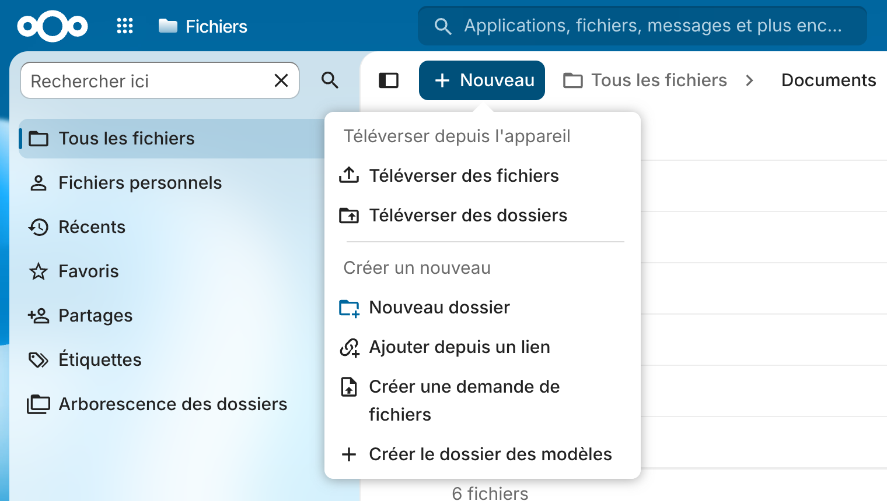
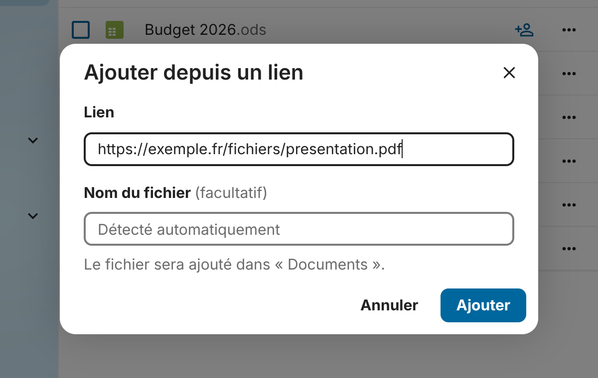
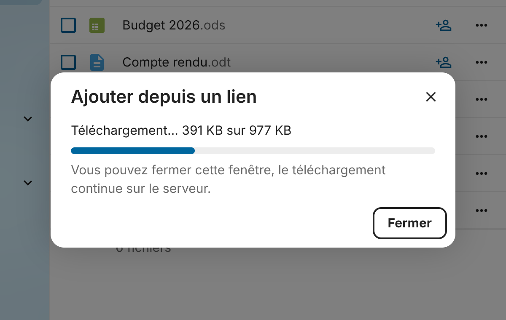

# Uplink pour Nextcloud

Ajoutez un fichier à votre Nextcloud directement depuis un lien Internet, sans le télécharger d'abord sur votre ordinateur.

Uplink ajoute une entrée **Ajouter depuis un lien** au menu **+ Nouveau** de l'application Fichiers. Le serveur télécharge le fichier et l'enregistre dans le dossier ouvert.



| Saisie du lien | Téléchargement |
| --- | --- |
|  |  |

## Fonctionnalités

- **Simple** : un lien, un nom de fichier facultatif, et c'est tout.
- **Progression en direct**, avec la taille téléchargée et la taille totale quand le serveur distant la fournit.
- **Le téléchargement continue sur le serveur** si vous fermez la fenêtre ou l'onglet ; le fichier apparaît dans la liste dès qu'il est prêt.
- **Nom de fichier détecté comme dans un navigateur** : en-tête `Content-Disposition` (y compris les noms accentués), puis l'adresse finale après les redirections, puis le type du fichier pour ajouter l'extension manquante (`photo` → `photo.png`, `download.php` → `download.pdf`, une page de connexion reçue à la place de `fichier.zip` → `fichier.zip.html`).
- **Extension ajoutée automatiquement** au nom choisi s'il n'en a pas : `rapport` devient `rapport.pdf`.
- **Aucun fichier écrasé** : `rapport.pdf` devient `rapport (2).pdf` si le nom est déjà pris.
- **Aucun fichier partiel** : le fichier est d'abord téléchargé dans un fichier temporaire, puis enregistré en une fois dans le dossier. Une erreur ne laisse rien derrière elle.
- **Quota respecté** : le téléchargement est arrêté dès qu'il dépasse l'espace libre.
- **Fichier enregistré tel qu'il est servi**, octet pour octet.
- **Sécurisé** : seules les adresses `http://` et `https://` sont acceptées, les adresses locales ou de réseau privé sont bloquées (protection SSRF de Nextcloud, redirections comprises), et la requête est protégée contre le CSRF.
- Fonctionne avec le chiffrement côté serveur et dans les dossiers partagés avec droit d'ajout.
- Interface en français et en anglais, thèmes clair et sombre, utilisable au clavier et sur mobile.

## Compatibilité

- Nextcloud **33 à 36**
- PHP **8.2** ou plus récent, avec l'extension `curl` (déjà requise par Nextcloud)

L'application a été testée sur Nextcloud 33.0.10, 35.0.2 et 36 (version de développement), avec nginx + PHP-FPM et avec Apache + mod_php.

## Installation

Le dossier de l'application **doit s'appeler `uplink`**.

```bash
cd /var/www/nextcloud/apps        # ou le dossier custom_apps de votre installation
sudo -u www-data git clone https://github.com/valentinbgt/uplink-nextcloud.git uplink
sudo -u www-data php /var/www/nextcloud/occ app:enable uplink
```

Les fichiers JavaScript compilés sont inclus dans le dépôt : il n'y a rien à compiler.

Pour mettre à jour :

```bash
cd /var/www/nextcloud/apps/uplink
sudo -u www-data git pull
```

Avec l'image Docker officielle, utilisez `docker exec -u www-data <conteneur> php occ app:enable uplink` après avoir cloné le dépôt dans le volume `custom_apps`.

## Utilisation

1. Ouvrez l'application **Fichiers** et allez dans le dossier de destination.
2. Cliquez sur **+ Nouveau**, puis sur **Ajouter depuis un lien**.
3. Collez le lien. Indiquez un nom de fichier si vous ne voulez pas du nom détecté automatiquement.
4. Cliquez sur **Ajouter**.

Vous pouvez fermer la fenêtre de dialogue pendant le téléchargement : une notification s'affiche quand le fichier est ajouté. Même si vous quittez la page, le serveur termine le téléchargement et le fichier apparaît dans le dossier.

## Configuration (facultative)

Aucune configuration n'est nécessaire. Les administrateurs peuvent toutefois régler :

| Réglage | Commande | Par défaut |
| --- | --- | --- |
| Taille maximale d'un fichier | `occ config:app:set uplink max_size --value="2 GB"` | aucune limite (le quota de l'utilisateur s'applique toujours) |
| Durée maximale d'un téléchargement, en secondes | `occ config:app:set uplink timeout --value=3600` | aucune limite |

Un téléchargement qui ne reçoit plus aucune donnée pendant 5 minutes est interrompu dans tous les cas. Pour revenir aux valeurs par défaut : `occ config:app:delete uplink max_size` (ou `timeout`).

Autres réglages utiles de Nextcloud :

- **Limiter l'application à certains groupes** : page *Applications* de l'administration, bouton *Limiter à des groupes*.
- **Proxy sortant** : Uplink utilise le client HTTP de Nextcloud, donc les réglages `proxy` et `proxyexclude` de `config.php`.
- **Adresses locales** : les liens vers `localhost` ou un réseau privé (`192.168.x.x`, `10.x.x.x`…) sont refusés. Pour les autoriser, ajoutez `'allow_local_remote_servers' => true` dans `config.php`. Attention : cela permet à tous les utilisateurs de faire envoyer des requêtes par le serveur vers votre réseau local.

## Bon à savoir pour les administrateurs

- Le fichier est d'abord écrit dans le dossier temporaire de PHP (ou celui défini par `tempdirectory` dans `config.php`), qui doit avoir assez de place pour les plus gros fichiers attendus.
- Chaque téléchargement en cours occupe un processus PHP. Sur un petit serveur, pensez à `pm.max_children` (PHP-FPM) et à un éventuel `request_terminate_timeout` qui couperait les longs téléchargements.
- La progression est envoyée en continu (avec l'en-tête `X-Accel-Buffering: no` pour nginx), ce qui évite que les proxys inverses coupent les longs téléchargements. Si un proxy retient malgré tout la réponse, le téléchargement se termine quand même sur le serveur.
- Un téléchargement commencé ne peut pas être annulé : supprimez le fichier une fois ajouté si besoin.
- Les échecs de téléchargement sont journalisés au niveau *info*, sans les identifiants ni les paramètres des liens.

## Développement

```bash
npm ci
npm run build      # compile src/ vers js/uplink-main.js et génère l10n/*.js depuis l10n/*.json
npm run watch      # recompile à chaque modification
```

Les traductions se trouvent dans `l10n/*.json` (le fichier `.js` correspondant est généré par la compilation).

Tests unitaires PHP :

```bash
composer install
vendor/bin/phpunit
```

ou, sans Composer, avec une copie du serveur Nextcloud : `NEXTCLOUD_SERVER=/chemin/vers/nextcloud phpunit`.

Archive prête à installer (dossier `build/`) : `make appstore`.

### Organisation du code

| Fichier | Rôle |
| --- | --- |
| `lib/Controller/DownloadController.php` | Point d'entrée `POST /apps/uplink/download`, qui renvoie la progression en JSON ligne par ligne |
| `lib/Service/DownloadService.php` | Validation, téléchargement, limites de taille, enregistrement dans le dossier |
| `lib/Service/FileNamer.php` | Choix du nom de fichier |
| `lib/Http/DownloadSink.php` | Écriture du fichier temporaire pendant le téléchargement, avec la limite de taille |
| `src/` | Entrée du menu, fenêtre de dialogue et suivi de la progression dans le navigateur |

## Licence

[AGPL-3.0-or-later](LICENSE). Icônes : [Material Design Icons](https://pictogrammers.com/library/mdi/) (Apache-2.0).
